# 3. Diseño

## 3.1 Arquitectura de la solución

Arquitectura **cliente estático**: no hay servidor de aplicación ni base de datos. Un hosting HTTPS entrega archivos; todo el procesamiento (video de la cámara, reconocimiento de la imagen, render 3D) ocurre en el navegador del usuario.

| Capa | Elementos | Responsabilidad |
|---|---|---|
| Soporte físico | Brochure (PDF/impreso), marcadores | QR de navegación e ilustraciones-marcador |
| Presentación | `index`, `lugar`, `ar`, `vista3d`, `marcadores`, `brochure`, `creditos`, `404` (HTML + `css/styles.css`) | Interfaz móvil, instrucciones, paneles de error |
| Contenido | `js/data.js` | Lugares, datos, relato, puntos de información y fuentes |
| Lógica de interfaz | `js/app.js` | Referencias a fuentes, hoja de información, comprobación de compatibilidad, mensajes de error de cámara |
| Modelos 3D | `js/models.js` | Constructores procedurales de los 3 modelos, animación, acciones y pines |
| Motor RA | A-Frame 1.6.0 + MindAR 1.2.5 (`vendor/`), `assets/targets/*.mind` | Cámara, seguimiento de imagen, escena 3D anclada |
| Motor 3D alternativo | three.js 0.164.1 + OrbitControls | Vista 3D sin cámara |
| Herramientas de construcción | `scripts/`, `tools/` | Marcadores, compilación `.mind`, GLB, brochure PDF, diagramas, pruebas |

**Decisión clave:** el mismo archivo `models.js` construye los modelos para la RA (con el THREE incluido en A-Frame), para la vista 3D (three.module) y para exportar GLB. Así las tres salidas no pueden divergir.

## 3.2 Diagrama de componentes

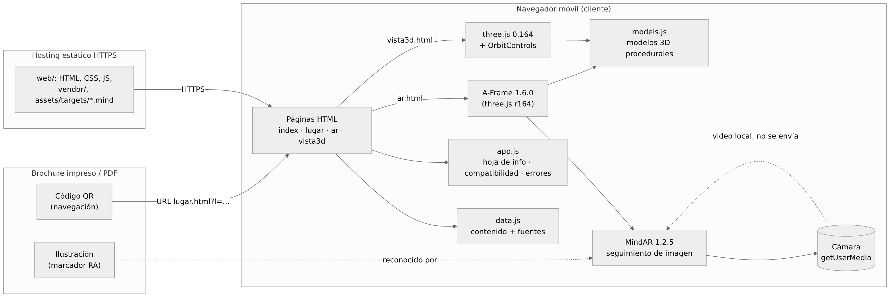

Fuente Mermaid: [`diagramas/01_componentes.mmd`](diagramas/01_componentes.mmd)

## 3.3 Diagrama de navegación

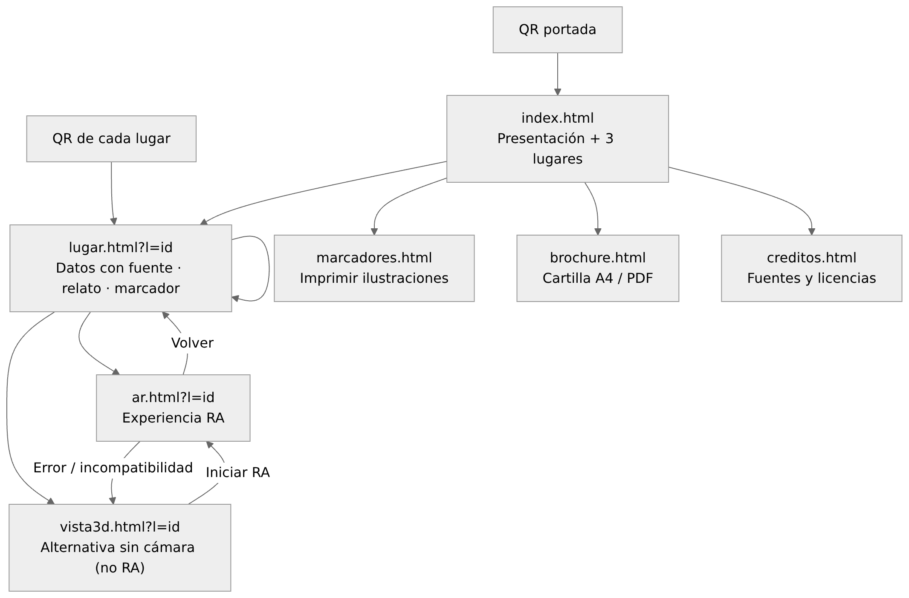

Fuente: [`diagramas/02_navegacion.mmd`](diagramas/02_navegacion.mmd)

## 3.4 Flujo de acceso mediante QR

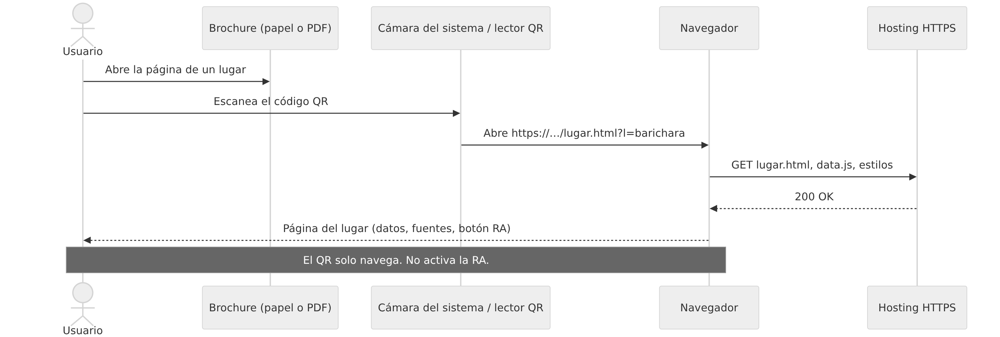

Fuente: [`diagramas/03_flujo_qr.mmd`](diagramas/03_flujo_qr.mmd)

Los QR codifican `https://<dominio>/<ruta>/lugar.html?l=<id>` (y `index.html` en la portada). Se generan en `brochure.html` con la URL donde se publica el sitio, o con `?base=` si se genera desde otro lugar. Corrección de errores nivel M, 32 mm impresos.

## 3.5 Flujo de activación de la realidad aumentada

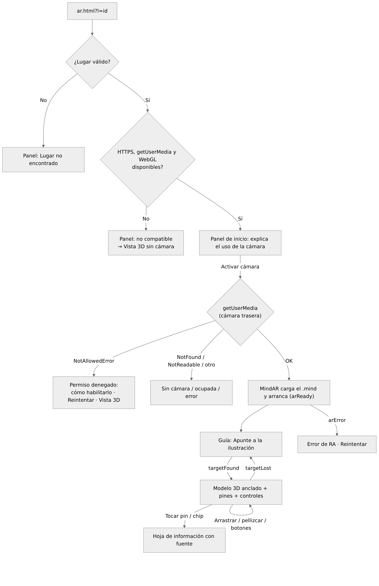

Fuente: [`diagramas/04_flujo_ra.mmd`](diagramas/04_flujo_ra.mmd)

Detalles de implementación:
- MindAR se configura con `autoStart: false`: la cámara no se abre hasta que el usuario pulsa «Activar cámara» después de leer la explicación.
- Antes de arrancar MindAR se hace un sondeo con `getUserMedia` para clasificar el error (`NotAllowedError`, `NotFoundError`, `NotReadableError`…) y mostrar un mensaje específico.
- El modelo se monta en una entidad hija del `mindar-image-target`, rotada 90° en X para que «arriba» sea perpendicular al papel. Escala inicial 0,8 para que se vea el borde de la ilustración.
- Los toques se resuelven con un `Raycaster` contra los *sprites* de los pines; arrastrar gira y pellizcar escala (`pointer events`).

## 3.6 Diseño de interfaces

Dirección visual: **cartilla impresa** — papel cálido (`#F4EDE1`), tinta oscura, botones rectangulares con borde y sombra desplazada (como tarjetas impresas), tipografía serif Fraunces para títulos y Work Sans para texto. Cada lugar tiene un acento: teja (Barichara), ocre (Chicamocha), verde de río (San Gil). Se evitan degradados decorativos, botones de pastilla y tarjetas repetitivas: los lugares se listan como filas editoriales numeradas. Es una dirección propia del proyecto, no una identidad institucional.

| Pantalla | Captura |
|---|---|
| Inicio (móvil) | 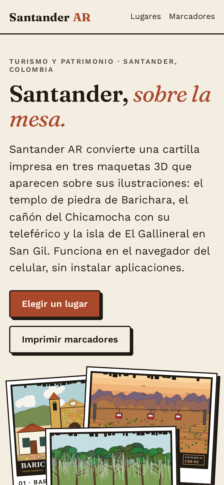 |
| Página de lugar (móvil) | 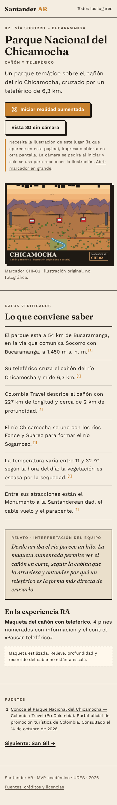 |
| RA: explicación previa a la cámara | 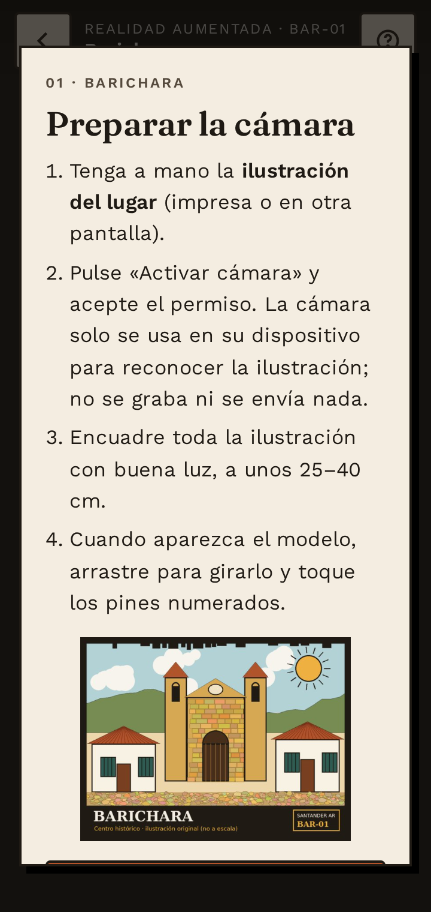 |
| RA: modelo anclado (cámara simulada) | 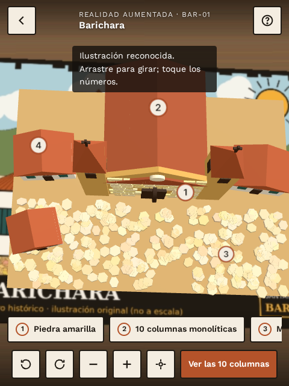 |
| RA: hoja de información tras tocar un pin | 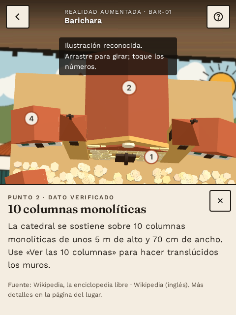 |
| Error: permiso denegado | 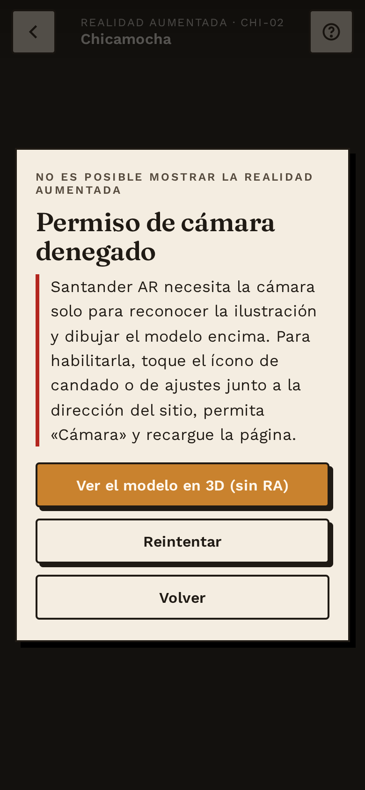 |
| Vista 3D sin cámara | 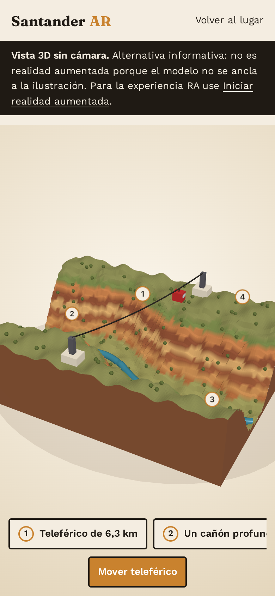 |

Componentes de la pantalla RA: barra superior (volver, lugar y código, ayuda) · guía de encuadre con esquinas y miniatura del marcador · aviso de estado · fila desplazable de chips de puntos · barra de controles (girar ⟲ ⟳, − +, restablecer, acción del lugar) · hoja inferior de información.

## 3.7 Estructura de carpetas

```
santander-ar/
├── web/                         ← sitio publicable (raíz de GitHub Pages)
│   ├── index.html  lugar.html  ar.html  vista3d.html
│   ├── marcadores.html  brochure.html  creditos.html  404.html
│   ├── css/styles.css
│   ├── js/data.js  app.js  models.js
│   ├── assets/markers/          ← ilustraciones-marcador (PNG) y miniaturas
│   ├── assets/targets/          ← marcadores compilados MindAR (.mind)
│   ├── assets/models/           ← modelos exportados (.glb) para reutilizar
│   ├── assets/img/icono.svg
│   └── vendor/                  ← A-Frame, MindAR, three.js, QR, fuentes (locales)
├── scripts/                     ← generación y servidor
│   ├── serve.mjs                ← servidor estático (HTTP o HTTPS autofirmado)
│   ├── generar_marcadores.py    compilar_targets.mjs   exportar_glb.mjs
│   ├── generar_brochure.mjs     renderizar_diagramas.mjs  generar_matriz.mjs
│   ├── generar_video_prueba.py  lib/browser.mjs
├── tools/                       ← páginas auxiliares de compilación/exportación
├── tests/                       ← e2e.mjs, test_qr.py, resultados, evidence/, fixtures/
├── docs/                        ← documentación (este directorio) y diagramas
├── entregables/                 ← brochure PDF y su lista de QR
├── .github/workflows/pages.yml  ← publicación automática
├── package.json  .npmrc  README.md
```

## 3.8 Inventario de recursos multimedia

| Recurso | Archivo | Tipo / tamaño | Origen | Licencia |
|---|---|---|---|---|
| Marcador Barichara | `assets/markers/barichara.png` | PNG 1200×900, 200 KB | Original, `generar_marcadores.py` | Propia del proyecto |
| Marcador Chicamocha | `assets/markers/chicamocha.png` | PNG 1200×900, 168 KB | Original | Propia |
| Marcador San Gil | `assets/markers/sangil.png` | PNG 1200×900, 268 KB | Original | Propia |
| Miniaturas | `assets/markers/*-thumb.jpg` | JPG 600×450, ~50 KB c/u | Derivadas | Propia |
| Marcadores compilados | `assets/targets/*.mind` | 656–716 KB c/u | Compilador oficial de MindAR | Propia (datos derivados) |
| Modelo Barichara | `js/models.js` → `assets/models/barichara.glb` | Procedural; GLB 108 KB | Original | Propia |
| Modelo Chicamocha | → `chicamocha.glb` | GLB 744 KB (terreno 120×88) | Original | Propia |
| Modelo San Gil | → `sangil.glb` | GLB 332 KB | Original | Propia |
| Animaciones | `models.js` (`update`) | Cabina, filamentos, espuma | Original | Propia |
| Ícono | `assets/img/icono.svg` | SVG | Original | Propia |
| Tipografías | `vendor/fonts/*.woff2` | 7 archivos, 152 KB | Fontsource (Fraunces, Work Sans) | SIL OFL 1.1 |
| A-Frame | `vendor/aframe-1.6.0.min.js` | 1,4 MB | npm `aframe@1.6.0` | MIT |
| MindAR | `vendor/mindar-image-aframe-1.2.5.prod.js` | 1,7 MB | npm `mind-ar@1.2.5` | MIT |
| three.js | `vendor/three/` | 660 KB | npm `three@0.164.1` | MIT |
| Generador QR | `vendor/qrcode-generator.js` | 60 KB | npm `qrcode-generator@2.0.4` | MIT |

No se usaron fotografías, videos ni modelos 3D de terceros. Las GLB usan la extensión `EXT_mesh_gpu_instancing` (adoquines, sillares, arbustos, piedras).

Carga aproximada de la experiencia RA (primera visita): A-Frame 1,4 MB + MindAR 1,7 MB + `.mind` ≈ 0,7 MB + HTML/CSS/JS/fuentes ≈ 0,3 MB ≈ **4,1 MB**.
